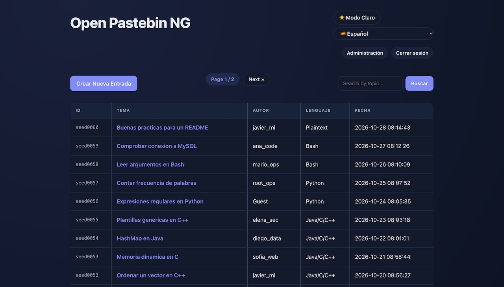
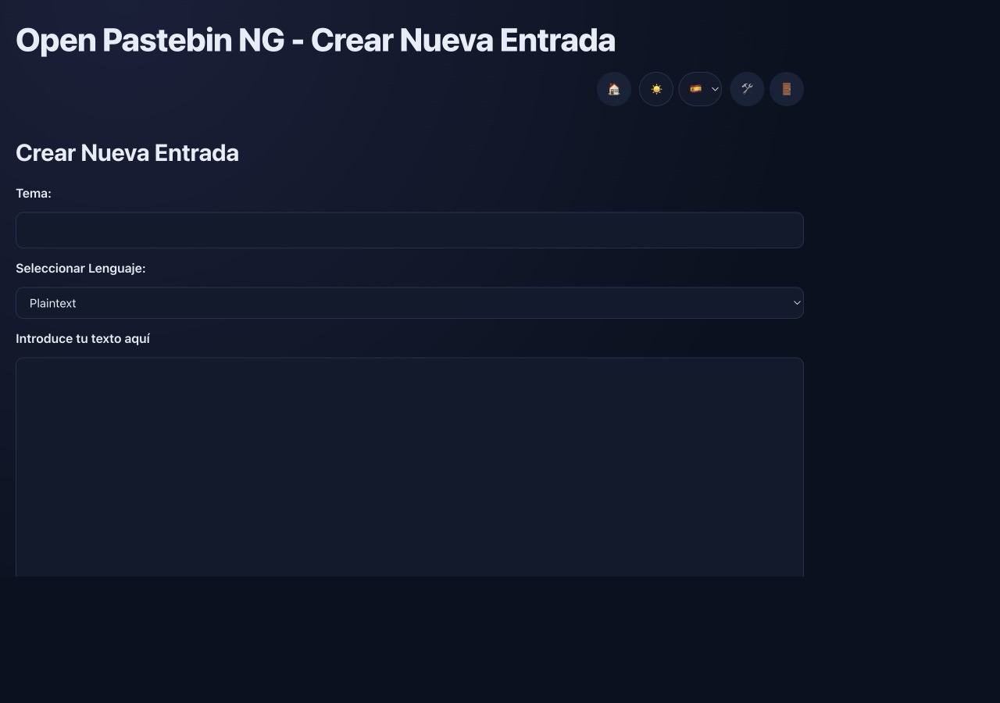
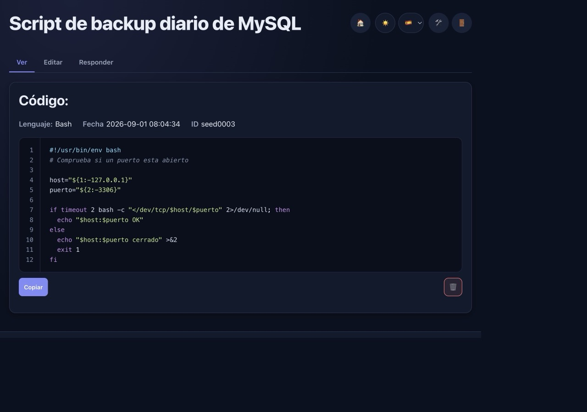
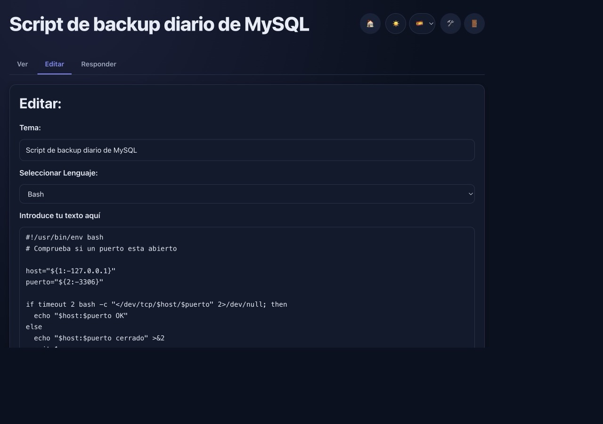
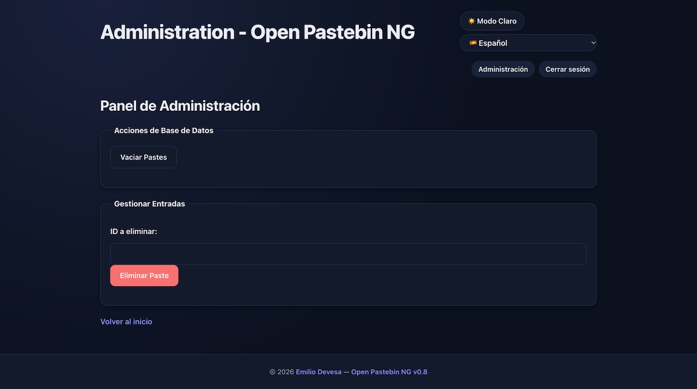

# Open Pastebin NG

**Open Pastebin NG** is an easy-to-use utility for sharing text and code through the web. It supports plain text as well as syntax highlighting for **PHP, Ruby, Bash, Python, Pascal, Java, C and C++**. See the feature list below for more details.

This project is based on **[Open Pastebin](http://sourceforge.net/projects/openpastebin/)**. All you need is a **web server with PHP and MySQL**.
Open Pastebin NG is **free software** released under the **[GNU GPL license](LICENSE)**.

⚠️ **This software is in BETA stage**, wich means it is still under development. Use it at your own risk.

---

## ✨ Features
- ✅ Simple and clean user interface
- ⚡️ Fast performance (no heavy images or media, just text)
- 🎨 Local syntax highlighting and accessible clipboard feedback for multiple programming languages
- 🌗 Light/dark theme with persistent toggle (no external fonts or frameworks)
- 🌐 Internationalization in 6 languages (English, Spanish, German, French, Portuguese, Chinese)
- 📱 Responsive layout (mobile-friendly tables, `prefers-reduced-motion` support)
- 🔓 Secure authentication system for administrative actions and role-based access control
- 👤 User management: **Admin**, **Registered User**, and **Guest**  
- 🛡️ CSRF protection for sensitive actions
- 📂 Entries are stored in a **MySQL database**

### Local syntax-highlighting asset

The browser uses a locally bundled, language-scoped build of **Highlight.js 11.12.0** (Bash, C, C++, Java, Pascal, PHP, Python and Ruby). It is served from `src/assets/vendor/` and does not contact a CDN. The upstream BSD-3-Clause license is included in [`src/assets/vendor/HIGHLIGHT-LICENSE.txt`](src/assets/vendor/HIGHLIGHT-LICENSE.txt). Clipboard access requires a secure context (HTTPS or localhost).

The shared interface uses a strict same-origin Content Security Policy. Keep scripts and styles in local assets; do not add inline handlers or inline styles, which the shipped Apache and Nginx policies intentionally block.

---

## 🖼️ Screenshots

### 📌 Homepage (List of Pastes)


### 📌 Create a New Paste


### 📌 View a Paste with Syntax Highlighting


### 📌 Edit a Paste


### 📌 Admin Panel


---

## 🛠️ Requirements
To run Open Pastebin NG, you need:

- **PHP 8.2.35**, **8.3.36**, **8.4.27** or **8.5.12** or later within that major/minor branch. These are the minimum patched versions currently enforced by `composer.json`; keep the runtime on the latest patch of a supported branch.
- **PHP extensions:** `mysqli` (database) and `gd` (CAPTCHA image)
- **MySQL 5.7** or MariaDB
- A web server (**Apache, Nginx or similar**)

### PHP runtime support

The minimum patch versions above include fixes for the PHP issues listed in the [NVD records for CVE-2026-109618](https://nvd.nist.gov/vuln/detail/CVE-2026-109618) and [CVE-2026-109619](https://nvd.nist.gov/vuln/detail/CVE-2026-109619), checked on 28 October 2026. This project does not make an exploitation-status claim. Do not infer a vulnerability from an identifier that has not been confirmed by an authoritative advisory.

Check the PHP project's [supported-versions table](https://www.php.net/supported-versions.php) before deployment and keep the actual web SAPI (PHP-FPM or Apache module) updated; checking only the CLI binary is insufficient. PHP 8.2 is in security-fixes-only support through 31 December 2026 according to that table. `composer.json` and the CI matrix define the project's current lower bounds and tested branches; these do not replace the PHP project's support policy.

OPNG does not upload files. Disabling PHP session upload progress is optional hardening, not a mitigation claim for an unverified advisory:

```ini
# Optional PHP-FPM pool hardening (restart workers after changing the pool):
php_admin_flag[session.upload_progress.enabled] = off
```

---

## 🚀 Installation
Follow this steps to install Open Pastebin NG:

1️⃣ **Clone the repository**

	git clone https://github.com/emilio-devesa/opng.git
	cd opng

2️⃣ **Configure the database**
Copy the example configuration and set your credentials:

	cp src/config.example.php src/config.php

`config.php` is **git-ignored** and must never be committed: it holds your database password. It is also blocked from HTTP access by `src/.htaccess` (and by the Nginx example).

Alternatively, leave the defaults and provide the values through environment variables (handy for Docker/CI):

	OPNG_DB_HOST=localhost
	OPNG_DB_USER=opng
	OPNG_DB_PASS=yourpassword
	OPNG_DB_NAME=opng

3️⃣ **Create the schema and least-privilege accounts**

Create the database and two MySQL accounts using an administrative connection. Replace the example passwords with unique secrets and restrict the host component to the application server:

```sql
CREATE DATABASE opng CHARACTER SET utf8mb4 COLLATE utf8mb4_unicode_ci;
CREATE USER 'opng_runtime'@'localhost' IDENTIFIED BY 'REPLACE_WITH_RUNTIME_SECRET';
GRANT SELECT, INSERT, UPDATE, DELETE ON opng.* TO 'opng_runtime'@'localhost';
CREATE USER 'opng_migrator'@'localhost' IDENTIFIED BY 'REPLACE_WITH_MIGRATION_SECRET';
GRANT SELECT, INSERT, CREATE, ALTER, INDEX, DROP ON opng.* TO 'opng_migrator'@'localhost';
```

The **runtime** account is for normal web requests and has DML access only. The **migration** account is used only from the CLI to install/upgrade schema; revoke or drop it after use. The installer does not create or drop databases.

Set the runtime credentials in `src/config.php` or the `OPNG_DB_*` environment variables. Run the installer from the repository root with the separate migration credentials:

```bash
OPNG_INSTALL_DB_HOST=localhost \
OPNG_INSTALL_DB_USER=opng_migrator \
OPNG_INSTALL_DB_PASS='your-migration-secret' \
php src/install.php
```

The CLI installer creates lowercase `users`, `entries` and `rate_limits` tables and the listing, cursor, owner and FULLTEXT topic indexes. It safely renames the legacy `Users`/`Entries` names only when the lowercase destination does not exist; ambiguous case variants stop the migration without deleting data. Existing `entries.text` is widened to `MEDIUMTEXT` for 1 MiB pastes. Re-run it with the migration account after schema upgrades; index creation is idempotent. Back up the database before schema migrations. Remove `install.php` from a public document root after installation even though it refuses web execution.

4️⃣ **Enforce input and request limits**

Paste text is limited to **1 MiB (1,048,576 bytes)** and topics to **255 bytes**. The server validates both limits on create and edit; the Nginx example allows a 4 MiB request body to account for form encoding. Configure PHP `post_max_size` to at least `4M` (and any reverse proxy/body limit accordingly). Normal accounts have a **100 MiB cumulative text quota** across owned pastes and replies; admins and anonymous pastes are exempt. Existing content is never removed by the quota. Accounts already over the limit may edit only without increasing their stored bytes. New and reset passwords must be 12–72 bytes; existing passwords remain valid for login.

The topic search uses a MySQL/MariaDB FULLTEXT index and requires all entered words; word-prefix matches are supported. It does not perform arbitrary substring matching. The database's minimum token length and stopword settings apply, so short words or stopwords may not match. The listing uses stable keyset cursors rather than page numbers and avoids a total-row count on each request. Translation catalogs use versioned URLs and browser caching.

> Since v0.8 there is no automatic migration on every request. A missing database now returns a connection error instead of being auto-created.

5️⃣ **Run the application**
- If using **Apache**, place the project in `htdocs` or configure a virtual host. The shipped `src/.htaccess` blocks direct access to `config.php`/`database.php`/`rules.xml` and the `includes/` directory, disables directory listings, adds security headers including a strict same-origin CSP, and disables `session.upload_progress`.
- If using **Nginx**, start from [`deploy/nginx.example.conf`](deploy/nginx.example.conf). It redirects HTTP to HTTPS, blocks the installer and internal files, denies `includes/`, sets security headers including a strict same-origin CSP, and disables CAPTCHA caching. Configure valid certificates before enabling the TLS server block.
- The example Nginx configuration terminates TLS directly and sets PHP's HTTPS state explicitly. If a trusted reverse proxy terminates TLS, configure the backend so that only the proxy can set the HTTPS state; do not trust arbitrary client-supplied `X-Forwarded-Proto`.
- Enable HSTS only after confirming HTTPS works across the entire hostname for the chosen max-age.
- **Use `src/` as the document root**, not the repository root, so `tools/`, `README.md` and `.git/` are never reachable over HTTP.
- Open `http://localhost/` for local development or `https://your-host/` in a TLS deployment.

### ✅ Production deployment checklist

- [ ] Use a PHP patch level at or above the Composer requirement and check the version/extensions used by the actual HTTP SAPI (`php-fpm -v` or the server's PHP module), not only the CLI.
- [ ] Install a valid TLS certificate, redirect HTTP to HTTPS, verify secure session cookies, and trust forwarded-protocol headers only from a controlled reverse proxy. Enable HSTS only after HTTPS is confirmed throughout the hostname.
- [ ] Set the document root to `src/`; keep the repository root and `tools/` outside HTTP reach. Because `src/config.php` is inside the document root, verify the web server denies direct access to it and other internal files, as well as `install.php`.
- [ ] Use a dedicated runtime database account with only `SELECT`, `INSERT`, `UPDATE` and `DELETE`. Run schema upgrades from the CLI with the separate migration account, back up first, then revoke or remove migration credentials.
- [ ] Keep `src/config.php` and database credentials out of version control and HTTP access. Set `post_max_size` and proxy request limits to at least `4M`.
- [ ] Configure private server/application logs, confirm visitors receive generic errors, and ensure the log path is writable only by the service account and administrators.
- [ ] After installation or upgrade, verify the expected schema/indexes, create and view a test paste, search and paginate, and confirm the HTTP error log has no database/configuration leaks.
- [ ] Test a database backup restore before relying on the deployment; a backup that has never been restored is not a verified recovery plan.

---

## 📌 Usage
From the homepage you can:

- 📝 **Create a new paste**: Enter your text or code, select a language and submit.
- 🔍 **View, edit and reply to a paste**: Click on the topic you want to view. The view page uses tabs — **View** (code), **Edit** (author or admin only) and **Reply** (creates a new paste). Includes syntax highlighting, line numbers and one-click copy.
- 🛠️ **Manage the application (Admin panel)**: Log in to `admin/admin.php` to search entries and users, remove entries, change user roles, delete accounts, and review paste/user totals, language distribution, the five most active users, and stored paste-text bytes. When deleting an account, choose whether to preserve its pastes as anonymous or delete them too.
- 💾 **Download a database backup**: Administrators can download a SQL backup from the database actions panel. It contains account password hashes and password-reset tokens, so store it securely. Importing the backup drops and recreates its listed tables; test restoration only against a disposable database.
- ⚠️ **Delete the database**: This remains a manual operation in MAMP's database administration tool. The web runtime account intentionally has no `DROP` permission, and the admin panel only provides the guarded instructions.

For security reasons, access to **admin features** is restricted to administrators.

---

## 🔒 User Roles & Permissions
👤 Guest
- Can view public pastes
- Can create pastes (anonymous pastes)
- Cannot delete any pastes
- Cannot edit any pastes

📝 Registered User
- Can create and manage their own pastes
- Can edit and delete only their own pastes
- Cannot access the admin panel

🛠️ Administrator
- Can manage entries, user accounts and roles through the admin panel
- Can edit or delete any paste (even from other users)
- Can empty all pastes via the admin panel (user accounts are preserved)
- Can download a SQL backup; deleting the whole database must be done manually in MAMP

---

## 🧪 Development

- **Contributing** — see [`CONTRIBUTING.md`](CONTRIBUTING.md) for issue reports, improvement proposals, pull requests, local development setup, test safety, and the repository structure.

- **`tools/seed.php`** — CLI-only seeder for local development. The admin panel's first database action opens safe-use instructions; it does not run the script through HTTP. It creates 10 users, 60 pastes and 12 replies for testing pagination, search, and permissions. Review [the seeder's cleanup scope and development password](CONTRIBUTING.md#development-setup-and-repository-structure) before running it; never use its fixtures in production.

  ```bash
  php tools/seed.php
  ```

- **Static analysis and linting** — the repo ships `composer.json`, `phpstan.neon` (level 5) and a GitHub Actions workflow (PHP 8.2–8.5).

  ```bash
  composer install
  composer lint      # php -l on every PHP file
  composer phpstan   # PHPStan level 5
  ```

  `src/config.php` is excluded from analysis. The PHPStan job needs no local configuration; the lint job creates a throwaway example config only for its isolated database-connection failure test.

- **MySQL integration tests** — the installation and query-plan tests write temporary rows (the plan test inserts 5,000 fixtures) and require a disposable database. CI creates an isolated schema and explicitly opts in; do not run these tests against the live MAMP database.

- **Rate limiting** — persisted in the `rate_limits` table (created by `install.php`) and keyed by a SHA-256 hash of IP (and IP+account for login). Limits: login 5/10 min, paste creation 5/min, registration and password-reset requests 5/hour.

- **Password reset** — real password-reset email delivery is not configured, so public reset requests are disabled by default. For local development only, set `OPNG_DEV_RESET=1` in the PHP process environment. The simulation also requires the request to come from `127.0.0.1` or `::1` with a `localhost`/loopback Host; it shows a one-time reset link as a simulated email, never a password. Do not set this flag in a shared or production environment. Reset tokens are stored as SHA-256 hashes, expire after 10 minutes, and are consumed once.

- **Password reset guard test** — run `php tests/password_reset_security_test.php` to verify the default-off behavior, loopback/Host checks and token hashing.

- **Local regression tests** — the following tests do not alter the database and can be run with the PHP CLI:

  ```bash
  php tests/input_validation_test.php
  php tests/search_pagination_test.php
  php tests/session_security_test.php
  php tests/permissions_test.php
  php tests/sql_backup_test.php
  php tests/frontend_contract_test.php
  ```

- **Database connection failure test** — CI runs `tests/database_connection_test.php` against an isolated runner with intentionally invalid credentials. It requires `OPNG_TEST_ALLOW_CONNECTION_PROBE=1`; do not set that flag for tests against a shared or production environment.

- **CAPTCHA** — generated locally with GD (160×60, noise, per-character rotation) and served with `Cache-Control: no-store`. No external service or API key is required.

- **Design** — `src/main.css` uses CSS design tokens (`:root` / `body.dark-mode`) for both light and dark themes, a responsive layout and `prefers-reduced-motion` support. The shared layout lives in `includes/layout_header.php` / `includes/layout_footer.php` (header with title, theme toggle, language selector, auth chips and search; footer with copyright and links). The view page presents *View / Edit / Reply* as tabs.

---

## ❓FAQ

### 🔷 Is it possible to share files, images, or binary files?
No, **Open Pastebin NG** is designed to share plain text and source code only. It does not support file uploads, images, or binary files.

### 🔷 How many pastes can I create? Is there any limitation?
There is no built-in limit on the number of pastes you can create. However, limitations may exist depending on:

- Your **server storage capacity**
- **Database size restrictions** set by your hosting provider

### 🔷 Where is my data stored? Is it private and safe?
Your pastes are stored in a **MySQL database** on your web server. Security depends on:

- Your **server configuration** (firewalls, database access, etc.)
- Proper use of **server permissions**
- Whether you enable **HTTPS** for secure connections

By default, **pastes are public** and **Open Pastebin NG does not support password-protected pastes** at the moment.
If this is an essential feature, consider submitting a **feature request**.
However, **registered users** can manage and delete their own pastes.

### 🔷 Is Open Pastebin NG available in more languages?
Yes! Open Pastebin NG supports multiple languages.
Currently available:
- 🇬🇧 English
- 🇪🇸 Spanish
- 🇩🇪 German
- 🇫🇷 French
- 🇵🇹 Portuguese
- 🇨🇳 Chinese

### 🔷 Can I download, fork, modify, and/or share again Open Pastebin NG?
Yes! **Open Pastebin NG** is **free and open-source software**, licensed under the **[GNU GPL version 2 or later](LICENSE)**.
You can:

- **Download** and install it on your server
- **Modify** it to fit your needs
- **Fork** the project and contribute improvements
- **Share** your version with the community

### 🔷 I found a bug and I lost my work!
I'm sorry to hear that! Please note that **OPNG is still in BETA stage and under development**. Please report the issue so we can fix it.

### 🔷 How can I uninstall OPNG and/or delete all data stored?
To completely remove Open Pastebin NG, follow these steps:

1. **Empty the pastes** from the administration panel (administrators accounts are preserved)
2. **Delete all files** from your server
3. **Clear your browser cache** if neccesary

This will remove **all pastes and files permanently**.

🚀 **Need more help?** Feel free to open an issue or reach out.

---

## ✅ Known Issues
- **Pastes created before v0.8** may show literal HTML entities (for example `&lt;` or `&amp;lt;`). Older versions escaped the text *before* storing it; v0.8 stores raw text and escapes at render time. Legacy content is intentionally left untouched — editing a paste and replacing the affected characters corrects it.
- Otherwise, there are no known issues. However, as this is a **BETA release**, some unexpected bugs may still exist.

---

🔷 **Found a bug?**
If you encounter any issue, please report it by:

- Opening an issue on Github
- Submitting a pull request with a fix

Your feedback is highly appreciated!

---

## 📜 License
Released under the [GNU General Public License, version 2 or later](LICENSE).

You are free to use, modify, and distribute this software under the terms of the GPL.
NOTE! THIS IS EXPERIMENTAL SOFTWARE MEANT ONLY FOR TESTING! USE AT YOUR OWN RISK!
I assume no responsibility for any damages if you choose to ignore the abovementioned warning

---

## 🛠️ Credits & Acknowledgments
This project is based on **Open Pastebin**, originally developed by:
**Ville Särkkälä** - villeveikko@users.sourceforge.net
